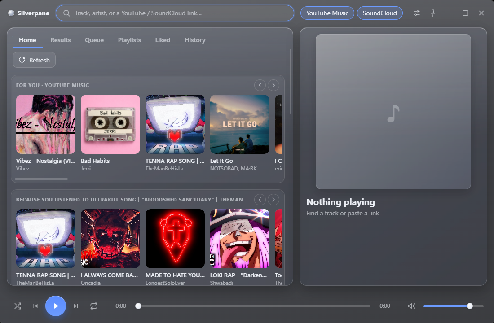
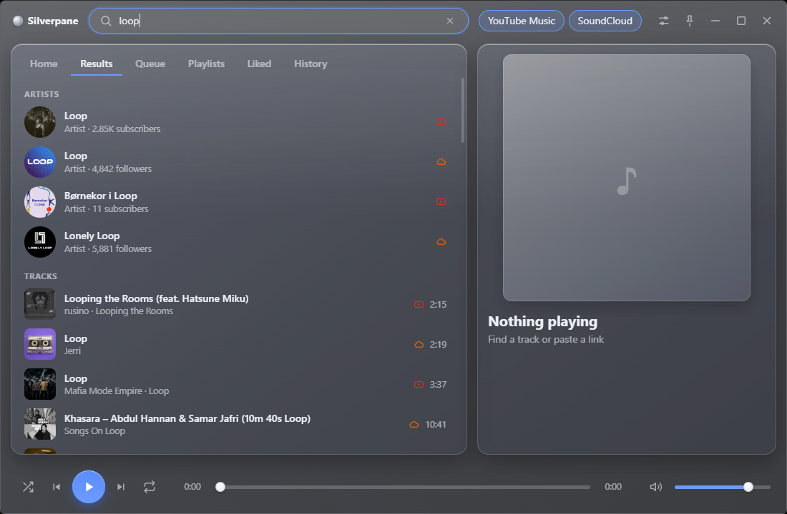
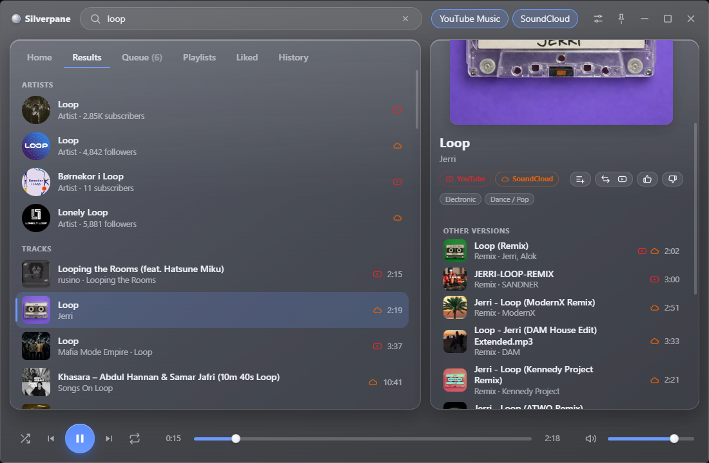
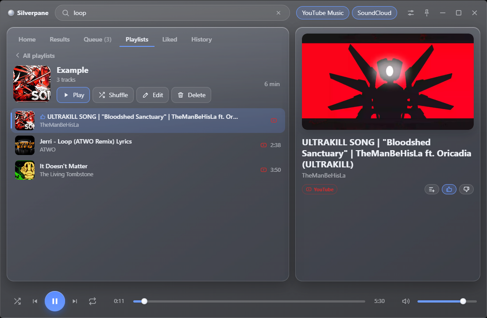

# Silverpane

A desktop music player with a frosted-glass interface. **YouTube Music, SoundCloud and your own files in one window**, no accounts and no ads from us.

<p align="center">
  
  
</p>
<p align="center">
  
  
</p>

## Download

Get the latest version from the [Releases page](https://github.com/BotrRobotgnom/silverpane/releases):

- **Windows**: `Silverpane-Setup-<version>.exe` (installer, updates itself) or `Silverpane-Portable-<version>.exe` (no installation).
- **Linux**: `Silverpane-<version>.AppImage`.

The builds are not code-signed yet, so Windows SmartScreen may show a warning on first launch ("More info" > "Run anyway").

Or run from source (Node.js 20+):

```bash
npm install
npm start
```

## What it does

**Search and play**
- One search over YouTube Music and SoundCloud, with one merged list ordered by relevance. Icons show which service has a track. Artists and playlists are found too.
- Paste a link to a YouTube track or to a SoundCloud track, playlist or artist.
- **Other versions**: remixes, slowed, sped up, live, covers and other uploads of a song sit in a framed block under the result (the first five, expandable) instead of cluttering the list. Songs with the same title by different artists are kept apart.
- **Service priority**: a three-position switch (YouTube, SoundCloud, none). When a track exists on both, the preferred one plays, and a button in the track panel switches to the other. If one service refuses to play a track, the other is tried automatically.
- Videos that forbid embedding are hidden or greyed out, checked before you press play.

**Recommendations**
- Play one track and the queue is that track plus a few similar ones; when it runs out, more are added.
- **Home**: picks from your history and likes, YouTube Music's own shelves and SoundCloud trends. Drag the shelves to scroll.
- Like or dislike tracks (the Liked tab). Disliked tracks stop being recommended.

**Pages**
- Artist, album and playlist pages with their tracks. Save any playlist to your own.

**Your library**
- **History** (recent, most played, forgotten for a while) and **playlists** with their own covers. Everything stays on your computer.
- **Local music**: create a playlist, press "Link a folder…" and pick a folder. Every audio file in it (and its subfolders: mp3, flac, wav, ogg, opus, m4a, aac, wma) becomes a track with its title, artist, album and cover art from the tags. The playlist is scanned again whenever you open it. Playing such a track from History continues through its playlist.

**Interface**
- Frosted glass over whatever is behind the window, Silver and Graphite themes, adjustable transparency, tray icon with a track tooltip, media keys, optional start with the system.
- Self-contained diagnostics: a debug window with a searchable, colour-coded log (Settings > Developer mode).
- Updates: installed builds update themselves from GitHub Releases. Pre-releases are available only if you switch them on.

Sound is played by the official embedded YouTube and SoundCloud players, and local files by the browser's own audio element. No streams are downloaded or decrypted.

## Window effect and transparency

Two separate settings:

- **Window effect** makes the operating system draw a blurred copy of whatever is behind the app.
- **Transparency** controls how much of that blurred backdrop shows through the interface tint (default 30%).

| Platform | Effects |
|---|---|
| Windows 11 (22H2 or newer) | Acrylic (see-through blur), Mica (wallpaper tint only), Off |
| macOS | Blur (vibrancy), Off |
| Windows 10, Linux | Off: the window is opaque |

On Windows the blur is drawn by the system, and [Microsoft documents](https://learn.microsoft.com/windows/uwp/style/acrylic) that acrylic turns into a flat colour when the window loses focus, when "Transparency effects" is off (Settings > Personalization > Colors), in Battery Saver mode, and on low-end hardware.

## Your data

Stored locally in the app data folder: `%APPDATA%\Silverpane` on Windows, `~/.config/Silverpane` on Linux. (Versions called "Glass Player" used a folder of that name; it is moved automatically on the first start.) It contains `history.json`, `playlists.json`, `reactions.json`, `blocked.json` and `covers/`. Each file has a `.bak` copy, and a damaged file is restored from it. Back the folder up or copy it to another PC to move your library.

Logs are in `logs/silverpane.log` there (rotated at 2 MB).

## Build

| Platform | Command | Output in `dist/` |
|---|---|---|
| Windows | `build.bat` (or `npm run dist`) | `Silverpane-Setup-<version>.exe`, `Silverpane-Portable-<version>.exe`, `latest.yml` |
| Linux | `./build.sh` (or `npm run dist:linux`) | `Silverpane-<version>.AppImage`, `latest-linux.yml` |
| macOS | `npm run dist:mac` (on a Mac only) | `.dmg`; without an Apple signature macOS will block it |

Build from a clone whose `origin` points to GitHub: `electron-builder` reads the owner and repository from it for auto-update.

## Releases and updates

1. Bump the version (`npm version <new> --no-git-tag-version`), add an entry to `CHANGELOG.md`, commit.
2. `git tag v<new>` and `git push origin v<new>`. GitHub Actions (`.github/workflows/release.yml`) builds Windows and Linux and creates a **draft** release.
3. Check the files and press **Publish**. Tick "Set as a pre-release" to offer it only to users who switched pre-releases on (see [VERSIONING.md](VERSIONING.md)).

## How it works

| File | Role |
|---|---|
| `src/main/main.js` | window, IPC, search, matching |
| `src/main/youtube.js`, `soundcloud.js` | YouTube Music (`youtubei.js`) and SoundCloud search, pages, embeddability checks |
| `src/main/match.js` | pairing the same track across services, grouping versions (pure logic) |
| `src/main/recommend.js` | Home and similar tracks |
| `src/main/library.js`, `local.js` | history, playlists, likes, local folders and tags |
| `src/main/updater.js`, `releases.js` | updates through GitHub Releases |
| `src/main/server.js` | local server (the YouTube iframe fails with error 153 from `file://`), also serves local files |
| `src/renderer/engines.js` | playback engines: YouTube IFrame API, SoundCloud Widget API, local audio |
| `src/renderer/app.js`, `home.js`, `pages.js`, `library.js` | interface |
| `src/renderer/locales/` | interface strings (English; another language is a new file plus a `<script>` tag) |

## Known limitations

- YouTube Music search uses the unofficial `youtubei.js`, and SoundCloud takes a public `client_id` from its own site. If either service changes its internal API, those parts will break until updated.
- Linking versions of one song across services is heuristic (title, artist, length, ISRC when SoundCloud provides it): an occasional wrong or missing match is possible.
- YouTube's embedded player shows ads, as any embed does.
- Local files cannot be added to ordinary playlists yet, and tags cannot be edited.
- No sign-in with YouTube or SoundCloud accounts.

## License

The code is open to read, but this is **not** open source in the OSI sense. It is licensed under [PolyForm Noncommercial 1.0.0](LICENSE):

- you may read, run, modify and fork the code, and share it, for personal and noncommercial use;
- you may **not** sell the app, its copies or derivative works, or use them commercially;
- copyright stays with the author. All copies and forks must keep the `LICENSE` file and the `Required Notice` line.

Commercial use is possible only with separate written permission from the author.

YouTube and SoundCloud belong to their owners. This project is not affiliated with them, and users are responsible for following their terms of service.

## Versions

The scheme is described in [VERSIONING.md](VERSIONING.md); the history is in [CHANGELOG.md](CHANGELOG.md).
